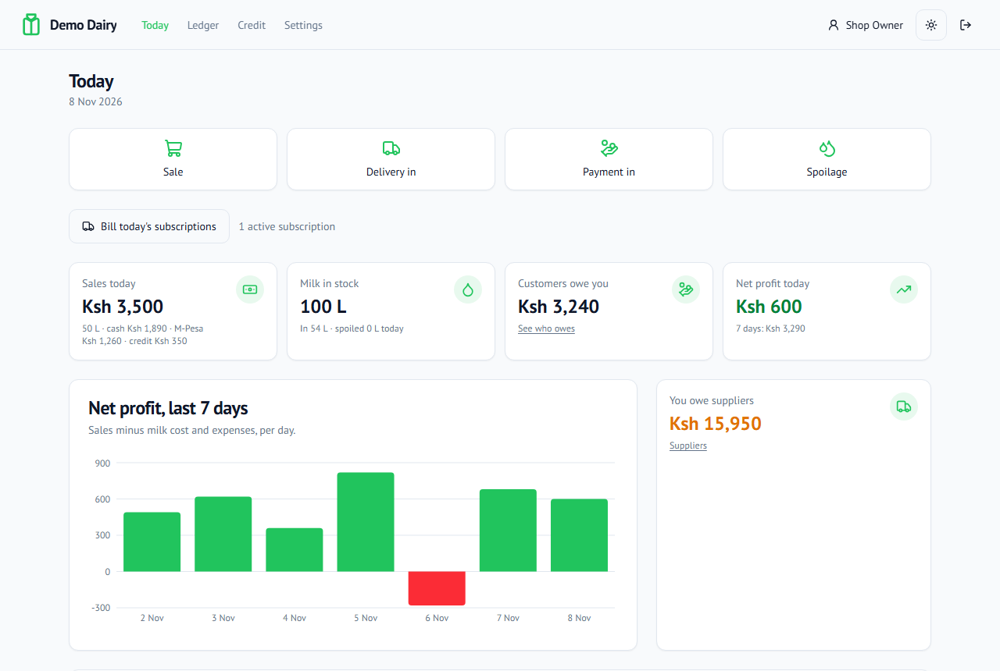
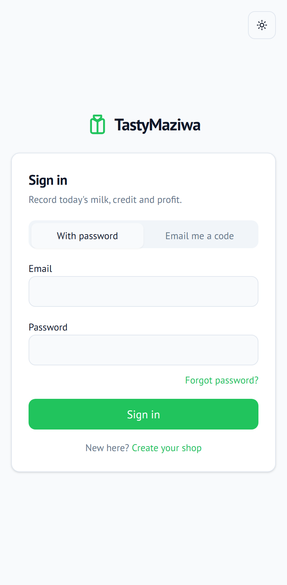
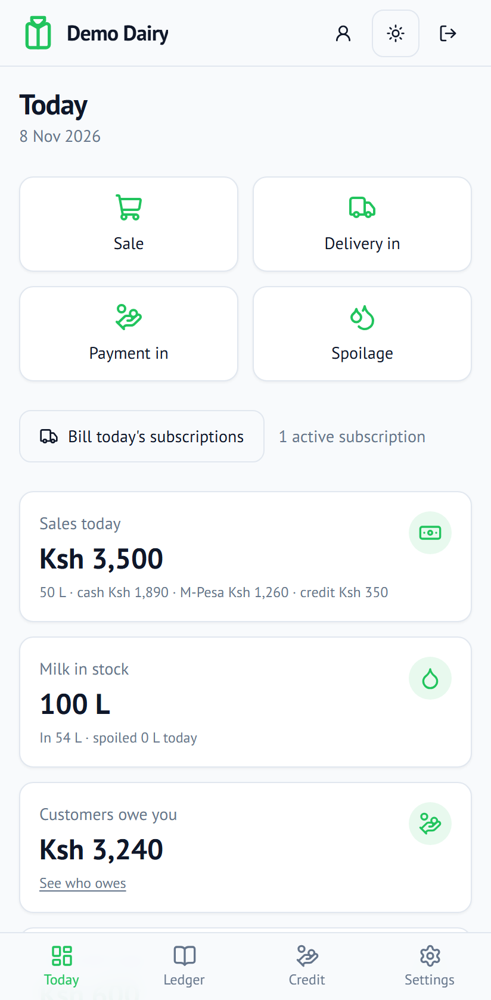
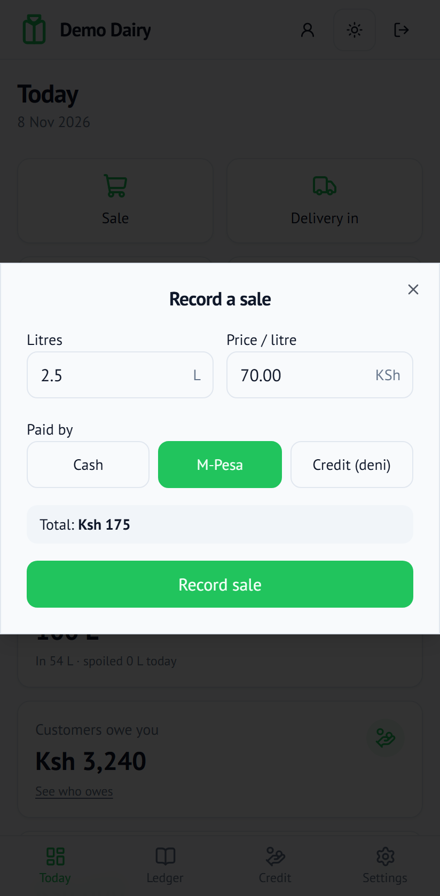
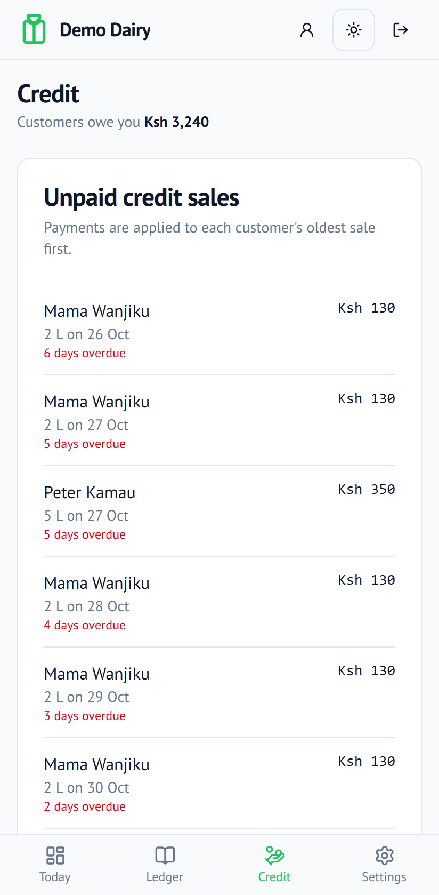
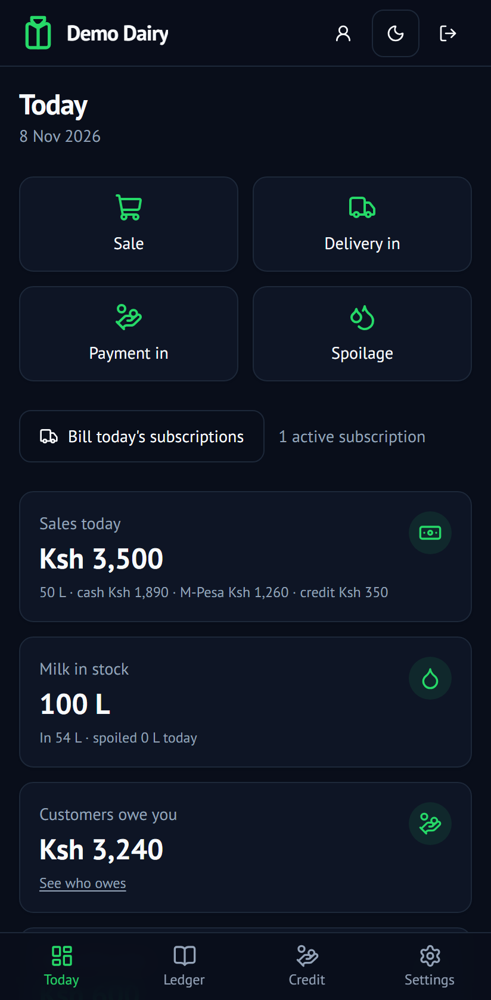

# 🥛 TastyMaziwa

**The daily book for a Kenyan milk shop.** Record what came in, what sold and who owes what, and see whether today made money. It's built for an attendant behind the counter with a cheap Android phone.

*Maziwa* means "milk" in Swahili. A maziwa duka buys milk in bulk from a milkman each morning and sells it by the litre for cash, M-Pesa or on credit (*deni*). TastyMaziwa replaces the exercise book and the mental arithmetic.



<table>
  <tr>
    <td align="center"><br /><sub>Sign in</sub></td>
    <td align="center"><br /><sub>Today</sub></td>
    <td align="center"><br /><sub>Record a sale</sub></td>
    <td align="center"><br /><sub>Who owes what</sub></td>
    <td align="center"><br /><sub>Dark mode</sub></td>
  </tr>
</table>

## What it does

| | |
|---|---|
| **Sales in three taps** | Enter litres and price, then choose **Cash / M-Pesa / Credit**. The total shows as you type, and the price pre-fills from the last sale. |
| **Deliveries and stock** | Log milk received from each supplier. Stock on hand is always *delivered − sold − spoiled*. |
| **Credit (*deni*)** | Each customer has a running balance. Payments are applied to their oldest sale first, and overdue sales are flagged in red. |
| **Daily subscriptions** | Standing orders (e.g. "2 L every morning") are billed to the customer's account automatically each day. You can pause or cancel them. |
| **Profit, honestly** | Gross profit (sales − milk cost) and net profit (− expenses), with a 7-day chart. Only owners see these figures. |
| **Supplier payables** | See what you owe each milkman and record payments as you make them. |
| **Mistakes are reversible, history isn't** | Nothing is ever edited or deleted. A wrong entry is *reversed* with a reason, so the record stays trustworthy. |
| **Your own shop in a minute** | Sign up with your shop name and email. Every shop's books are completely private, and the database itself refuses cross-shop references. |
| **Sign in your way** | With a password, or passwordless with a 6-digit code sent to your email. Forgot your password? Reset it with an emailed link. |
| **Locks itself** | After 30 minutes without activity (and always after a 12-hour shift) you're signed out, so an unattended phone doesn't show your books. |
| **Owner and attendant roles** | Invite staff by email. Attendants record sales, deliveries and payments. Owners also see profit, record expenses, reverse entries, and manage or deactivate the team. |
| **Audit trail** | Every change records who made it and when. |

## Quick start

You need **Node.js 22+**. You don't need a database server: locally the app uses [PGlite](https://pglite.dev), a full Postgres that runs inside Node and stores its data in `.data/`.

```bash
git clone https://github.com/cngetich37/tastymaziwa.git
cd tastymaziwa
npm install

cp .env.example .env.local     # then set AUTH_SECRET:  npx auth secret
npm run db:seed -- --demo      # a demo shop with owner@example.com (password printed once) + 2 weeks of data
npm run dev                    # → http://localhost:9002
```

Sign in as `owner@example.com` with the password the seed script printed, or create a new shop at `/signup`.

**Emails in development** (sign-up and sign-in codes, reset links, staff invites) aren't sent: they're printed in the dev server log and saved to `.data/outbox/`. Set the `SMTP_*` variables to send real email.

> **Tip:** PGlite allows one process at a time. Stop `npm run dev` before running any `db:*` script.

## Scripts

| Command | What it does |
|---|---|
| `npm run dev` | Dev server with Turbopack on port 9002. The local database migrates itself. |
| `npm run build` / `npm start` | Production build and server. A local `npm start` needs `AUTH_TRUST_HOST=true`. |
| `npm run lint` / `npm run typecheck` | ESLint and TypeScript checks. |
| `npm test` | Vitest unit tests plus integration tests against an in-memory Postgres. |
| `npm run test:e2e` | Playwright tests on a phone-sized screen. Run `npm run build` first. |
| `npm run db:seed [-- --demo]` | Create a demo shop, its owner and a default supplier, plus demo data with `--demo`. |
| `npm run db:generate` | Generate a SQL migration after editing `src/db/schema.ts`. |
| `npm run db:migrate` | Apply migrations (needed for hosted Postgres). |
| `npm run db:studio` | Browse the database in Drizzle Studio. |

## Tech stack

- **[Next.js 16](https://nextjs.org) App Router** with **React 19**: Server Components for pages, Server Actions for writes
- **PostgreSQL** via **[Drizzle ORM](https://orm.drizzle.team)**, running on PGlite locally and hosted Postgres (Neon, Supabase…) in production
- **[Auth.js](https://authjs.dev)** (next-auth v5): password and passwordless email-code sign-in, scrypt password hashes, per-shop roles
- **[Nodemailer](https://nodemailer.com)** over SMTP for sign-up codes, sign-in codes, password resets and invites
- **[Zod 4](https://zod.dev)** schemas shared by forms ([react-hook-form](https://react-hook-form.com)) and the server
- **[Tailwind CSS v4](https://tailwindcss.com)** + **[shadcn/ui](https://ui.shadcn.com)**, with charts by [Recharts](https://recharts.org)
- **[Vitest](https://vitest.dev)** + **[Playwright](https://playwright.dev)**, with CI on GitHub Actions
- Deployed on **[Vercel](https://vercel.com)** with Vercel Cron

## How the numbers work

Every event (a sale, a delivery, a payment, an expense, spoiled milk) is one row in an **append-only ledger**. Nothing stores a running balance. Every figure on screen is calculated from the ledger:

```
Stock on hand      = litres delivered − litres sold − litres spoiled
Customer balance   = credit sales − payments received
Owed to supplier   = cost of deliveries − payments made
Gross profit       = sales − cost of milk delivered
Net profit         = gross profit − expenses
```

The database enforces the rules itself, so a bug can't quietly corrupt the books:

- A trigger rejects any `UPDATE` or `DELETE` on the ledger. A correction is a new *reversal* row.
- Money is stored as **integer cents** and volume as **integer millilitres**, so floating-point rounding errors can't creep in.
- "Today" means the **Nairobi** calendar day, whatever timezone the server runs in.
- Subscription billing is idempotent: each customer is billed at most once per day, however many times the job runs.

## Accounts and security

- **Multi-tenant.** Every table holding shop data has a `shop_id`, every query filters by it, and composite foreign keys stop a row from ever referencing another shop's customers, suppliers or entries. Tests check that shops are isolated.
- **Codes and links** are single-use, expire (codes in 10 to 15 minutes, reset links in 30), and are stored only as keyed hashes. A code dies after 5 wrong guesses.
- **No account enumeration.** "Send code", "forgot password" and sign-up answer the same way whether or not an email is registered.
- **Rate limits:** 3 emails per address per 15 minutes; 5 failed passwords lock that address for 15 minutes (email codes still work).
- **Sessions** slide forward with activity, expire after 30 minutes idle and 12 hours in total, and end everywhere when a password is reset or a user is deactivated.

## Project structure

```
src/
├── app/
│   ├── (app)/            # signed-in pages: Today, Ledger, Credit, Account, Settings
│   ├── (auth)/           # sign in, sign up, forgot and reset password
│   ├── actions.ts        # signed-in Server Actions: authenticated, role-checked, validated
│   ├── auth-actions.ts   # signed-out actions: sign-up, codes, password reset (rate-limited)
│   └── api/cron/         # daily subscription billing (Vercel Cron)
├── db/                   # Drizzle schema and connection
├── server/               # ledger writes, read queries, auth flows (server/auth)
├── lib/                  # money, dates, validation, pure calculations (all unit-tested)
└── components/           # UI, including forms/
drizzle/                  # SQL migrations
e2e/                      # Playwright tests
scripts/                  # seed, migrate
```

## Deployment (Vercel)

1. **Create a Postgres database.** Vercel has no persistent disk, so the local PGlite fallback can't run there. [Neon](https://neon.tech) or [Supabase](https://supabase.com) both work; use their **pooled** connection string.
2. **Set the project's environment variables:**

   | Variable | |
   |---|---|
   | `DATABASE_URL` | Pooled Postgres connection string. Give Preview its own database or branch. |
   | `AUTH_SECRET` | Generate with `npx auth secret`. |
   | `CRON_SECRET` | Any long random string. Vercel Cron sends it automatically. |
   | `SMTP_HOST`, `SMTP_PORT`, `SMTP_USER`, `SMTP_PASS`, `EMAIL_FROM` | Your mail provider's SMTP settings (e.g. Gmail with an app password, Zoho, Brevo). Required: sign-up and sign-in codes are emailed. |
   | `APP_URL` | Optional. Your custom domain, used in email links. Defaults to the Vercel production URL. |

3. **Migrate** production from your machine:
   ```bash
   DATABASE_URL="<production url>" npm run db:migrate
   ```
   No seeding is needed: open the site and sign up to create your shop.
4. **Push to `master`** and Vercel deploys. `vercel.json` schedules subscription billing every day at **06:00 Nairobi time** (03:00 UTC).

Migrations don't run during the build. After a schema change lands on `master`, run `npm run db:migrate` against production.

## Contributing

- Read **[`CLAUDE.md`](CLAUDE.md)** first. It covers the architecture, ledger rules, coding conventions and the definition of done. It's written for AI coding agents, but it's the best guide for people too.
- **[`docs/ROADMAP.md`](docs/ROADMAP.md)** lists what's planned, including M-Pesa STK Push, SMS reminders for overdue credit, offline support and a Swahili interface.
- Before pushing, run `npm run lint && npm run typecheck && npm test`, and `npm run build && npm run test:e2e` for UI changes. CI runs the same checks.
- Commit messages follow [Conventional Commits](https://www.conventionalcommits.org).
